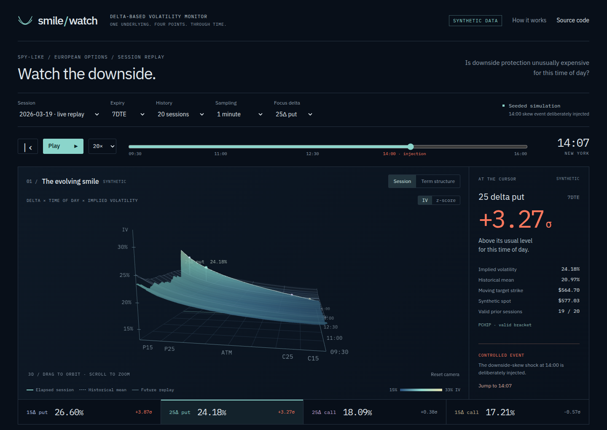

# smile-watch



[Live replay](https://pinyacolada.github.io/smile-watch/) · [Download the offline HTML](https://github.com/PinyaColada/smile-watch/raw/refs/heads/main/docs/index.html) · [Plain engine plots](artifacts/engine-diagnostics.png)

Tracks 15Δ and 25Δ put/call IV as their target strikes move with synthetic spot.<br>
Derives risk reversals and wings, with a separate time-of-day baseline for each series.<br>
Compares each reading with the same minute in previous completed sessions, never today.<br>
Replays a fully synthetic session in linked 3D surfaces and 2D charts, including a disclosed injected event.<br>
Measures unusualness, not predictive value; no real market data or trading signals are claimed.

## Run

Requires Python 3.11 and Node.js 22.18 or later. All runtime JavaScript libraries and fonts
are bundled locally. The published page has no backend, keys, CDNs, telemetry or external requests.

```sh
make setup
make run          # rebuild all data and serve http://127.0.0.1:8080
make test lint
npm test         # browser-side statistics and export parity
```

The full seeded build takes about four minutes on the development machine. To serve the
committed build immediately, use `make serve`; to use it with no server or connection,
download **only `docs/index.html`** and double-click it. Its data, JavaScript and fonts are embedded.
The standalone HTML is approximately 3.4 MiB; `docs/data/` also contains canonical compressed
binary and JSON exports for inspection. The compact export does not replace the full-precision engine.

```sh
.venv/bin/smile-watch build                 # data and SQLite only
.venv/bin/smile-watch build --seed 20260319 # explicit reproducible default
make plots                                # full-precision diagnostic plots
npm run build                             # package the existing export into docs/index.html
npx playwright install chromium
npm run test:browser                       # fresh offline browser, mobile and WebGL fallback
```

The optional `CHROMIUM_PATH` environment variable selects an installed Chromium binary.
Use `SMILE_WATCH_REPO=https://github.com/OWNER/smile-watch npm run build` when publishing a fork.

Docker builds the dataset and frontend, then serves only static files as an unprivileged user:

```sh
docker build -t smile-watch:demo .
docker run --rm -p 127.0.0.1:8080:8080 smile-watch:demo
```

## Replay

The replay opens paused at 14:07 in the final synthetic session, where the injected
7DTE 25Δ put reading is **24.18% IV, +3.27σ** against a **20.97%** historical mean.
There are 19 valid observations in the default 20-session window at that time because
one prior session is a half-day. Use the reset button to start at 09:30.

Choose a historical session, expiry bucket, history window, sampling interval and target.
The cursor links the surface, live smile, four IV series, skew series, z-scores and alert strip.
The z-score chart switches between IV and skew series. Click a threshold alert or time chart
to jump. Drag the 3D scene to orbit; scroll or pinch to zoom; reset its camera when needed.

| Key | Action |
| --- | --- |
| Space | Play / pause |
| Left / right | Step one selected sampling interval |
| `[` / `]` | Slower / faster replay |
| Home | Return to session open |

Controls retain their native keyboard behavior when focused. Reduced-motion preferences
are respected; playback is opt-in. If WebGL is unavailable or its context is lost, the same
controls continue to operate a 2D delta heatmap and the linked charts.

The solid surface is elapsed replay; future data are deliberately faint. This is an **ex-post
replay**, not a trading screen that conceals future information. The statistical baselines
still exclude the current session completely. Historical mean surfaces are known from prior
sessions. Term surfaces connect four labelled expiry buckets; the space between them is
visual interpolation, not additional contracts or independently estimated maturities.

## Methodology and limits

**Everything displayed is synthetic.** Thirty prior sessions plus a final replay session
contain one-minute, SPY-like option chains on $1 strikes for 0DTE, 1DTE, 7DTE and 30DTE.
An SSVI total-variance model evolves level, skew and curvature; level mean-reverts around
an opening premium, midday lull and late-session rise. Spot drawdowns raise volatility and
steepen downside skew. The clean slices satisfy sufficient butterfly constraints; noisy
quotes and the combined expiry surface are not claimed to be globally arbitrage-free.
See [the full methodology](artifacts/METHODOLOGY.md) and
[Gatheral and Jacquier's SSVI paper](https://arxiv.org/abs/1204.0646).

**The event is injected.** In `synth.py`, the final session starts a deliberate downside-skew
shock at 14:00 New York, ramping over a few minutes and decaying over 45 minutes. It changes
spot, level, skew and curvature. A regression test requires the default 7DTE P25 z-score to
cross +3. This is a demonstration scenario, not an anomaly found in actual market history.

**Pricing and interpolation.** NumPy/SciPy implement European Black–Scholes with spot delta,
a 4% continuously compounded rate and 1.2% dividend yield. Stable OTM pricing plus put-call
parity supports deep strikes; Brent and vectorized bracketed bisection recover IV. Prices
that cannot identify IV at floating-point precision are unavailable. Recovered deltas must
bracket each target; local PCHIP interpolates IV in delta space, using up to four valid
neighbors. It never selects the closest strike or extrapolates. Moving strike labels use
linear interpolation of the same two bracket strikes. Stale, missing, crossed or excessive-spread
quotes, nonmonotonic deltas, gaps over $2 and expired options produce explicit unavailable flags.

**Derived series.** RR25 = C25 − P25; RR15 = C15 − P15; put wing = P15 − P25;
call wing = C15 − C25. Each derived series has its own baseline. A strongly negative
risk-reversal z-score can indicate unusually expensive downside protection even when the
put-IV z-score is positive. Units are annualized IV fractions internally and volatility
percentage points in the UI.

**No look-ahead.** For every reading, `z = (value − mean) / std` uses the preceding N
completed sessions, at the same minute since the 09:30 New York open and matching expiry
bucket. The current session never enters its own baseline. Standard deviation uses `ddof=1`;
eight valid historical observations are required, and near-zero variance is unavailable.
A window counts sessions, not valid observations, so missing quotes do not extend it.

**Calendar and sampling.** The deterministic demo calendar spans a US DST transition and
includes two explicitly fictitious 13:00 half-days; it is not an exchange calendar. UTC
storage plus minutes since the local open avoids DST misalignment. Missing half-day
afternoons stay missing. DTE is calendar days; some synthetic expiries fall on weekends.
Within each session, each bucket follows a fixed actual expiry. At the exact expiry instant,
0DTE IV is unavailable. Thirty-second resampling carries forward minute observations;
five-minute resampling selects causal endpoint observations. Neither invents intraminute data.

**Storage and export.** `build/smile-watch.sqlite` stores session, UTC timestamp, actual expiry,
tenor bucket, minute, series, value, flags and synthetic provenance; missing values are SQL NULL.
Raw quote chains are reproducible from the seed. `build/engine.npz` retains full precision.
Browser values use signed integer quantization at 1/50,000 IV (maximum rounding error 0.001
volatility percentage points), with separate missing sentinels and quality flags. Browser
baseline parity is tested within a 0.025σ tolerance across all eight event series. The time
surface uses two-minute geometry with every minute retained around the injected shock;
charts and statistics retain the full minute history. The 17-point surface is recovered from
the chains; the four monitored points are highlighted, not used to fabricate a dense smile.

**IBKR.** The IBKR adapter has NOT been tested against a live account.

`IBKRSource` implements the same `get_chain(underlying, expiry, ts)` contract as the synthetic
source and is tested with mocks. It defaults to paper TWS on `127.0.0.1:7497` and connects
read-only through `ib_async`; no credentials or order submission are included. It retrieves
current snapshots, not historical option-chain backfills, and rejects delayed data. Real
integration would change data entitlements, pacing, retries, exchange calendars, dividend
and American exercise treatment, and quote freshness handling: a receipt timestamp is not
a guarantee of exchange freshness. The static published replay never connects to IBKR.

## Engineering checks

Python tests cover BS delta finite differences, IV round trips across strikes and maturities,
tiny prices, analytic delta-space interpolation, full-chain recovery, malformed quotes,
no-look-ahead, sample counts, half-days, DST, causal resampling, SQLite nulls, export precision,
seed reproducibility, the injected-event regression and mocked IBKR contracts.
Browser-side tests compare exported statistics against full-precision Python calculations.
Playwright checks fresh offline loading, every selector, keyboard controls, expired 0DTE,
insufficient history, alert jumps, 3D modes, mobile overflow and a deliberately disabled WebGL context.

Artifacts from the phased implementation:
[engine plots](artifacts/engine-diagnostics.png), [2D replay](artifacts/replay-2d.png),
[3D replay](artifacts/replay-3d.png), [z-score surface](artifacts/replay-z-surface.png),
[term surface](artifacts/replay-term.png), [mobile](artifacts/replay-mobile-3d.png).
The browser checker measures JavaScript update cost across every replay minute; those numbers
are local measurements, not a promise about every device or network.

## GitHub Pages

The committed `docs/` tree works independently of Actions. To enable the build-and-deploy
workflow, choose **Repository → Settings → Pages → Build and deployment → Source → GitHub Actions**.
Push to `main`, or run **Actions → Build and deploy synthetic replay → Run workflow**.
The workflow rebuilds the synthetic data, tests the engine and browser, and deploys only static files.
The job's deployment URL is the authoritative published URL.

If Actions is unavailable, choose **Deploy from a branch → main → /docs → Save** instead.
That publishes the already committed build. No secrets are required for either option.
[GitHub's Pages configuration guide](https://docs.github.com/en/pages/getting-started-with-github-pages/configuring-a-publishing-source-for-your-github-pages-site).

The requested [social preview](artifacts/social-preview.png) is a 1280 × 640 capture of the
actual synthetic visualization. Upload it under **Settings → General → Social preview**.
The site also includes Open Graph metadata pointing to its own copy.

## What I would do next

- Monitor multiple expiries simultaneously with maturity-aware baselines.
- Add exchange timestamp, liquidity, parity and arbitrage quote-quality filters.
- Replace the generator with a licensed real data vendor and audited session calendar.
- Add alert delivery with deduplication, acknowledgment and explicit data provenance.

None of these changes would establish predictive value; that would require a separate study.
